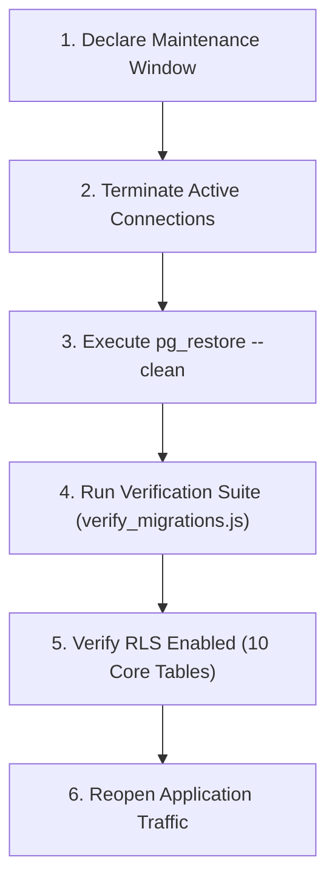

# Database Backup & Disaster Recovery Guide
**Project:** Run for Victory by Ravi Kumar  
**Database:** PostgreSQL 15+ (Supabase)  
**Target RTO (Recovery Time Objective):** < 30 minutes  
**Target RPO (Recovery Point Objective):** < 5 minutes  

---

## 1. Backup Architecture & Policies

Run for Victory enforces a two-tier backup strategy to ensure zero data loss:

1. **Continuous Physical Backups (PITR - Point-in-Time Recovery):**
   - Supabase Write-Ahead Logging (WAL) continuously archives all database mutations to secure multi-region cloud object storage.
   - Allows restoring the database to any millisecond within the retention window (7 to 30 days).
2. **Automated Logical Backups (`pg_dump`):**
   - Scheduled daily full logical backups taken at 02:00 AM IST (low-traffic window).
   - Encrypted with AES-256 and stored off-site.

---

## 2. Performing a Logical Backup

Execute the standard PostgreSQL logical dump command using custom binary format (`-F c`):

```bash
pg_dump \
  -h <supabase_db_host> \
  -p 5432 \
  -U postgres \
  -d postgres \
  -F c \
  -b \
  -v \
  -f "run_for_victory_backup_$(date +%Y%m%d_%H%M%S).dump"
```

### Flags Explanation:
- `-F c`: Custom format (compressed, supports parallel restoration and selective table restoration).
- `-b`: Includes large objects (blobs) if any.
- `-v`: Verbose mode for comprehensive backup auditing.

### Verifying Backup File Integrity:
Verify the backup file without writing to the database:
```bash
pg_restore -l run_for_victory_backup_<timestamp>.dump | head -n 30
```

---

## 3. Disaster Recovery Restoration Procedure

In the event of accidental data corruption, administrative error, or primary region outage, execute the following step-by-step restoration procedure:



### Step 3.1: Declare Maintenance Window & Terminate Connections
Temporarily block incoming application traffic in the Supabase Dashboard or API Gateway, then terminate lingering connections:
```sql
SELECT pg_terminate_backend(pid) 
FROM pg_stat_activity 
WHERE datname = 'postgres' AND pid <> pg_backend_pid();
```

### Step 3.2: Restore from Dump File
Restore the database using clean, idempotent drop-and-recreate flags:
```bash
pg_restore \
  -h <supabase_db_host> \
  -p 5432 \
  -U postgres \
  -d postgres \
  --clean \
  --if-exists \
  -v \
  run_for_victory_backup_<timestamp>.dump
```

### Step 3.3: Verify Restoration Order & Table Dependencies
The table dependency graph was audited in `verify_migrations.js` as an acyclic DAG. Restoration executes in foreign-key safe order:
1. `tuition_centres`
2. `profiles`
3. `students`
4. `parent_student_links`
5. `teacher_attendance`
6. `student_attendance`
7. `daily_work_reports`
8. `account_invitations`
9. `in_app_notifications`
10. `device_tokens`

### Step 3.4: Post-Restoration Verification
Run the automated verification test suites against the restored database:
```bash
node supabase/tests/verify_migrations.js
node supabase/tests/verify_security_rules.js
```

Confirm Row-Level Security is active on all tables:
```sql
SELECT tablename, rowsecurity 
FROM pg_tables 
WHERE schemaname = 'public';
```

---

## 4. Point-In-Time-Recovery (PITR) Execution

For recovering from specific timestamps (e.g. accidental bulk deletion at 04:15 PM):
1. Navigate to the **Supabase Dashboard** $\rightarrow$ **Database** $\rightarrow$ **Backups** $\rightarrow$ **Point in Time**.
2. Select target point in time: `2026-10-25 16:14:00+05:30` (1 minute prior to incident).
3. Click **Restore Database**. Supabase spins up a restored snapshot and verifies WAL replay.
4. Verify record counts and re-enable API traffic.
